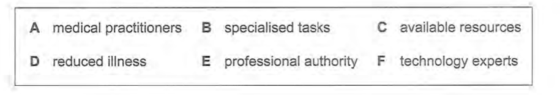
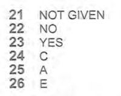
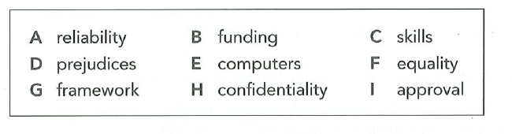
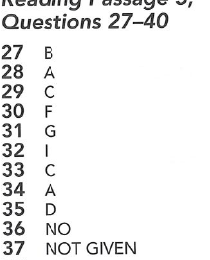
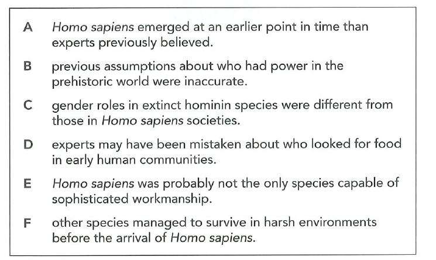
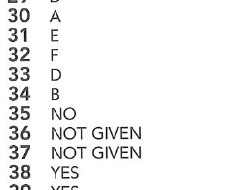
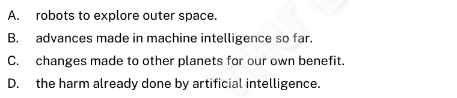
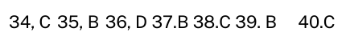

# 阅读选项来源核对

这些图片直接由此前提供的原始 PDF 通过 Poppler 渲染并裁切，内容来自书页，不由本站题库文字重新排版生成。`sources.json` 记录原 PDF 的 SHA-256、PDF 页码、纸页页码、渲染尺寸、裁切坐标及图片 SHA-256。完整原书不纳入源码。

|题组|选项原页摘录|答案页摘录|核对字母|
|---|---|---|---|
|剑18 Test2 Q24–26|||C / A / E|
|剑21 Test2 Q30–35|||F / G / I / C / A / D|
|剑21 Test3 Q31–34|||E / F / D / B|
|剑20 Test3 Q34–36|||C / B / D|

前三组共 13 题的选项文字、顺序和答案字母已逐项对照这些摘录。剑20 的三题附在同一证据集中。剑21 Test3 六句尾此前由改写恢复为原书措辞，来源可直接在上图复核。

复现（需要取得与清单哈希相同的原书，安装 Poppler）：

```sh
python3 scripts/render-reading-evidence.py /path/to/books
```

本次渲染工具为 `pdftoppm 26.05.0`，使用 `-scale-dimension-before-rotation` 保持旋转 PDF 的渲染坐标一致。不同 Poppler 版本可能生成不同 PNG 字节，但 PDF 哈希、页码、坐标和可见文字应一致。

`bookOptions.test.ts` 是选项与答案的回归快照，不能独立证明原书内容；`bookEvidence.test.ts` 只检验这套证据文件完整且与清单哈希匹配。来源核验以本目录的原页摘录及可重现的来源信息为依据，不能把测试数量当成来源证明。
